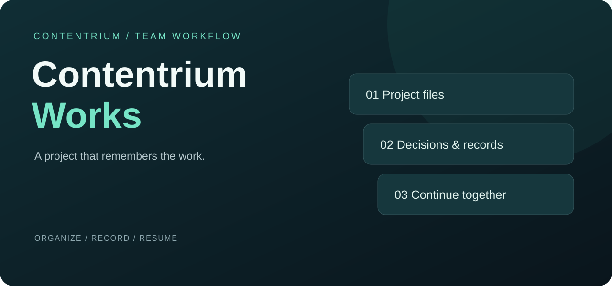
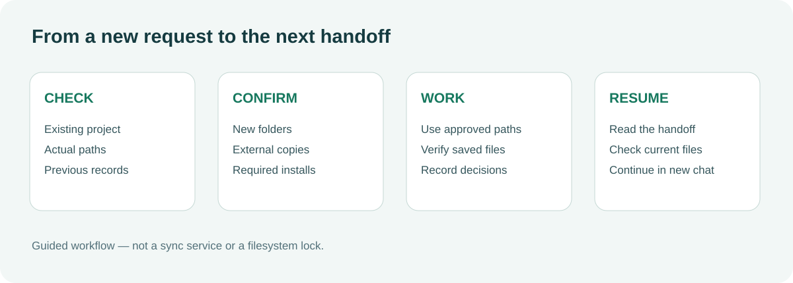

<p align="center"></p>

<h1 align="center">Contentrium Works</h1>
<p align="center"><strong>작업은 정리하고, 다음 사람은 이어서.</strong><br>영상·문서·기획·지원사업부터 개발까지, 팀의 프로젝트 파일과 작업 기록을 관리하는 Codex 스킬입니다.</p>
<p align="center"><a href="https://github.com/contentriumkorea/contentrium-works/releases/latest"></a> <a href="docs/installation.md"></a></p>
<p align="center"><a href="#빠르게-시작하기">설치하기</a> · <a href="https://github.com/contentriumkorea/contentrium-works/releases/latest/download/contentrium-works.zip">다운로드</a> · <a href="#사용-모습">사용 모습</a> · <a href="docs/installation.md">상세 안내</a></p>

---

## 빠르게 시작하기

스킬을 설치할 수 있는 Codex 환경이 필요합니다. ZIP을 내려받아 Codex에 제공하고 다음과 같이 요청하세요.

[](https://github.com/contentriumkorea/contentrium-works/releases/latest/download/contentrium-works.zip)

```text
첨부한 Contentrium Works를 설치해줘.
포함된 설치 안내에 따라 기존 개인 지침은 그대로 유지하고
상시 검토 문구만 중복 없이 추가해줘.
```

설치 담당 에이전트가 기존 지침을 백업하고 공통 문구만 추가합니다. 개인 지침 전체를 교체하지 않습니다. ZIP을 수동 복사하는 것만으로 지침이 바뀌지는 않습니다.

[상세 설치 및 업데이트 안내 →](docs/installation.md)

## 프로젝트에 남기는 세 가지

| 01 · 파일의 위치 | 02 · 결정의 이유 | 03 · 다음 작업 |
| :--- | :--- | :--- |
| **기존 구조를 존중** | **승인과 변경을 기록** | **새 대화에서도 재개** |
| 적합한 폴더를 재사용하고, 새 분류는 제안 후 생성합니다. | 외부 자료 복사·정리·설치의 범위를 확인합니다. | 인계 기록과 실제 파일을 대조하고 다음 작업을 이어갑니다. |

## 사용 모습

<p align="center"></p>

**프로젝트 폴더 안에 파일의 위치와 작업의 맥락을 함께 남깁니다.**

위 그림은 스킬의 작업 절차를 설명하는 도식입니다. 별도 앱 화면이나 자동 동기화 기능을 나타내지 않습니다.

<details><summary><strong>추가 예시 보기</strong></summary>

- 영상: 문서와 제작 자료가 함께 쌓일 것을 고려합니다. 기존 구조를 우선하고, 필요한 경우 서류 안에 계약·기획·촬영 운영을 묶는 안을 제안합니다. 제작 자료는 기존 Footage·Sequence·Export 등에서 관리하며 빈 폴더를 미리 만들지 않습니다.
- 지원사업: 적합한 폴더가 없으면 공고·신청·증빙 등의 최소 분류를 제안합니다.
- 외부 이미지: 복사 여부를 확인하고 승인 후 프로젝트 안의 복사본을 실제 작업에 사용합니다.
- 경로 오류: 폴더가 없다고 새 프로젝트를 만들지 않고 경로부터 확인합니다.
- AI 작업 기록: `AI Worklog/대화명/`을 공통 기본 위치로 제안하고 사용 도구는 기록 안에 남깁니다. 기존 기록 폴더는 승인 없이 이동하거나 통합하지 않습니다.
- 보관 후 재개: 현재 프로젝트 경로에서 인계 기록과 실제 파일을 확인합니다.

</details>

## 설치와 배포

| 방식 | 사용 방법 |
| :--- | :--- |
| 릴리스 ZIP | 스킬·설치 안내·공통 상시 검토 문구가 포함됩니다. Codex에 설치를 요청하세요. |
| 저장소 | 루트의 SKILL.md와 agents·references·assets가 스킬 본체입니다. 설치 절차는 references/installation.md를 따릅니다. |
| 팀 배포 | 직원 개인 계정 설정을 공유하지 않고, 각 환경의 기존 개인 지침에 공통 문구만 추가합니다. |

## 이렇게 사용하세요

```text
이 프로젝트의 기존 구조를 확인해서 보고서 작업을 이어줘.
외부 자료가 필요하거나 새 분류를 만들어야 하면 먼저 알려줘.
```

설치와 상시 검토 설정 후에는 별도로 스킬 이름을 매번 부를 필요가 없습니다. 단순 질문에는 불필요한 폴더·문서를 만들지 않습니다.

## 최신안과 이전안 관리

새 결과물 묶음의 저장·검증이 성공하면 같은 결과물의 기존안을 해당 폴더 아래 `이전안`으로 보관합니다. 통상 보관은 매번 재승인을 묻지 않습니다. Word와 대응 PDF처럼 함께 쓰는 최신 형식은 묶음으로 남깁니다.

기존 파일은 원래 이름과 내용으로 보존합니다. 동명 충돌은 내용을 확인하고 별도 하위 폴더로 분리하며 삭제·덮어쓰기로 처리하지 않습니다. 생성 실패나 검증 미완료이면 기존안을 옮기지 않습니다. 원본·참고·소스·설정·연결 자산은 대상에서 제외하고 제작 파일은 의존성을 확인합니다. 이동 후 보존 상태와 프로젝트 안내·인계 링크를 갱신합니다.

이 규칙은 현재 작업의 결과물 버전 관리에 적용되며 과거 프로젝트 전체의 일괄 정리나 폴더 재편 승인이 아닙니다. 별도 사용자 보관 지시가 우선합니다. [상세 기준](references/files.md#결과물-버전-보관)

## 영상 프로젝트의 분류

최상위는 자료의 큰 성격으로 나누고, 문서의 업무별 분류는 `서류` 같은 문서용 폴더 안에 묶는 안을 검토합니다. 예를 들어 `서류/계약 및 기획`, `서류/촬영 운영`, `서류/행사 참고자료`가 가능합니다. 기존 `문서`·`etc` 등이 같은 역할이면 재사용합니다.

예시 이름·깊이·구조를 강제하지 않습니다. 실제 자료에 필요한 폴더만 승인 범위에서 만들며, 비영상 프로젝트에 영상 폴더를 적용하지 않습니다. 기존 최상위 폴더를 재분류할 때는 승인·원본 보존·연결 검증과 기록 갱신 절차를 따릅니다. [상세 기준](references/files.md#영상-프로젝트의-문서와-제작-자료-분류)

## 공용 도구 사용

웹 검색·브라우저·데스크톱 도구는 사용자 지정과 현재 환경에 맞게 선택합니다. 특정 제품을 강제하지 않으며 개인 도구 설정은 각자의 지침에서 관리합니다. 필요한 도구 설치는 출처·범위를 설명하고 승인받은 뒤 진행합니다.

**헤드리스 UI 조작도 앱에 따라 포커스를 가져갈 수 있습니다.** 전경 창과 대상 창을 확인하고, 포커스를 보장할 수 없는 백그라운드 조작은 보내기 전에 건너뜁니다. 포커스 보존이 확인된 전용 API나 파일 조작을 우선합니다. 실제 마우스·키보드·창 포커스가 필요한 경우에는 제한을 알리고 명시적 허락을 기다립니다. 개인 Telegram 계정이나 수신자 설정은 포함하지 않습니다. [포커스 보호 절차](references/dependencies.md)

## Windows·macOS 공통 사용

OS 전용 실행 파일 없이 동일한 문서 기반 ZIP을 사용합니다. 실제 설치 위치는 각 환경에서 확인하고, 공유 파일명·경로 인용·상대 링크·수신 PC의 자산 연결을 검증합니다. 개인 도구 설정은 각자 유지합니다.

**Mac 실기기 검증은 아직 수행하지 않았습니다.** v1.0.9의 검증은 패키지 정적 검사와 Windows 압축 해제·파일 비교입니다. macOS 설치·새 대화 인식·파일 작업·포커스 보호와 Windows↔macOS Dropbox 왕복은 미검증이며 완전 호환을 보장하지 않습니다. [설치 절차와 검증 범위](references/installation.md)

## 적용 범위와 제한

- 영상·문서·기획·지원사업·견적·스토리보드·개발 등 다양한 프로젝트에 적용합니다. 영상 폴더 구조를 모든 작업에 강제하지 않습니다.
- 기존 경로를 조회하고 유사 이름과 외부 참조를 확인합니다. Dropbox 같은 공유 폴더의 동시 편집은 담당자·반영 절차가 필요합니다.
- 파일 잠금, 동기화 서비스, 모든 메시지의 실시간 백업은 제공하지 않습니다. 모든 요청의 자동 실행이나 PC 간 충돌 방지를 기술적으로 보장하지 않습니다.
- 실제 제작은 해당 전문 스킬·도구로 진행합니다. 필요한 외부 도구의 설치는 출처와 범위를 안내하고 승인받습니다.
- 새 세션에서 스킬과 개인 지침의 인식을 확인해야 합니다. 직원 PC별 동작과 실제 Dropbox 다중 PC 동시 작업은 검증되지 않았습니다.

<details><summary><strong>상세 안내와 검증 범위</strong></summary>

[파일 관리](references/files.md) · [공유 작업](references/shared-work.md) · [기록과 재개](references/records.md) · [의존 도구](references/dependencies.md)

스킬 형식, 문서 연결, ZIP 내용과 설치본 일치를 검사했습니다. 시나리오는 지침 수준에서 검토했으며 실제 에이전트의 모든 상황 준수나 다중 PC 동작을 실증한 결과가 아닙니다.

</details>

<details><summary><strong>English overview</strong></summary>

Contentrium Works is a Codex skill for shared project organization, approval-aware file handling, handoff records, and resuming work in a new chat. Installation preserves existing personal instructions and adds a small always-review instruction. It is not a synchronization service, filesystem lock, or complete chat backup system.

</details>

---

<p align="center"><strong>콘텐츠리움 · Contentrium</strong><br><a href="LICENSE">MIT License</a> · <a href="https://github.com/contentriumkorea/contentrium-works/releases/latest">Latest release</a></p>
<sub>Copyright © 2026 Contentrium. MIT License.</sub>
<p align="center"><a href="https://contentrium.com/"></a></p>
